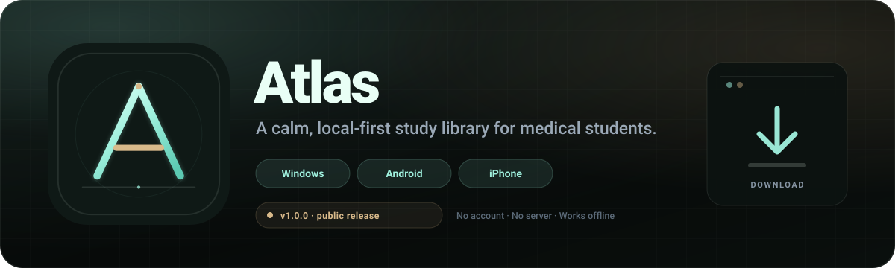

<p align="center">
  
</p>

<p align="center">
  <a href="https://github.com/dreamboy7777/atlas-study-library/releases/tag/v1.0.0"></a>
  
  
  
</p>

<p align="center">
  <a href="https://github.com/dreamboy7777/atlas-study-library/releases/download/v1.0.0/atlas-windows.zip"></a>
  <a href="https://github.com/dreamboy7777/atlas-study-library/releases/download/v1.0.0/atlas-android.apk"></a>
  <a href="https://github.com/dreamboy7777/atlas-study-library/releases/download/v1.0.0/atlas-ios.ipa"></a>
</p>

<p align="center">
  <a href="https://dreamboy7777.github.io/atlas-study-library/"><b>Download page</b></a> ·
  <a href="https://github.com/dreamboy7777/atlas-study-library/releases/tag/v1.0.0">Release notes</a> ·
  <a href="https://dreamboy7777.github.io/atlas-study-library/downloads/SHA256SUMS.txt">Checksums</a>
</p>

---

## Download

| Platform | File | Size | Notes |
|---|---|---:|---|
| **Windows 10/11** | [`atlas-windows.zip`](https://github.com/dreamboy7777/atlas-study-library/releases/download/v1.0.0/atlas-windows.zip) | 102 KB | Portable ZIP. Unzip, then double-click `Start Atlas.bat`. |
| **Android 7+** | [`atlas-android.apk`](https://github.com/dreamboy7777/atlas-study-library/releases/download/v1.0.0/atlas-android.apk) | 1.2 MB | Debug-signed APK. Allow installs from your browser or Files app. |
| **iPhone / iPad 15+** | [`atlas-ios.ipa`](https://github.com/dreamboy7777/atlas-study-library/releases/download/v1.0.0/atlas-ios.ipa) | 596 KB | Unsigned IPA. Sideload with AltStore or Sideloadly. |

All three packages open the same single-file Atlas app and keep your library on the device.

## Install

### Windows

1. Download the portable ZIP.
2. Unzip it anywhere you like.
3. Double-click **`Start Atlas.bat`**.
4. Use Chrome or Edge on the same machine to keep your library.

There is no installer and no admin rights required.

### Android

1. Download the APK.
2. Open it and allow installs from your browser or Files app when prompted.
3. Open Atlas and create your first account.

The APK is debug-signed and is not distributed through the Play Store.

### iPhone / iPad

1. Download the IPA.
2. Install AltStore or Sideloadly on a computer.
3. Connect your iPhone and sideload **`atlas-ios.ipa`**.
4. Trust the developer profile in **Settings → General → VPN & Device Management**.

> **The iPhone IPA is unsigned.** It will not install by tapping it in Safari, and there is no App Store build. A sideloading tool and a computer are required.

## First run

- Create the first account using the admin passcode in [`SETUP.md`](SETUP.md).
- **Change the admin passcode immediately** in **Site settings**.
- Set your site name, tagline, logo, theme, announcement, and footer.
- Add the modules your batch actually uses, then upload the first files.
- Export a JSON backup from **Admin console → Export library** once you have real material.

Students create their own accounts; they do not need the admin passcode.

## What is inside

- **Library** — batches, years, modules, semester grouping, type/subject filters, search, and PDF preview.
- **Batch access** — 198 → Years 1–3, 199 → Years 1–2, 200 → Year 1. Admins see all years.
- **Admin tools** — upload and review queue, member database, sign-in log, unpublish/delete, JSON export/import.
- **Customization** — site name, tagline, logo letter/emoji, five themes, announcement banner, footer note, admin passcode.
- **Modules** — 28 built-in modules plus unlimited custom modules, with safe deletion rules.
- **Social** — reactions, saved files, lounge chat synced between tabs, and a meme break.
- **Local-first** — accounts, PDFs, chat, memes, and settings live in IndexedDB and `localStorage` on your device. No cloud account and no Atlas server.

## Privacy

Atlas does not upload your library anywhere. There is no cloud account, no telemetry, and no Atlas server.

- Clearing browser or app data deletes the library. Export a backup first.
- The admin passcode gates the admin UI; it is not disk encryption. Do not reuse a real password.
- The default passcode is public in the source. Change it on first run.

## Docs and source

- [`SETUP.md`](SETUP.md) — first-run, admin, modules, backups, and troubleshooting.
- [`DATA_MODEL.md`](DATA_MODEL.md) — taxonomy rules and the data model.
- [`atlas.html`](atlas.html) — the single-file app.
- [`mobile/`](mobile/) — Android and iPhone WebView wrappers.
- [`downloads/`](downloads/) — built ZIP, APK, IPA, and `SHA256SUMS.txt`.
- [`.github/workflows/build-mobile.yml`](.github/workflows/build-mobile.yml) — CI build for the APK and unsigned IPA.

> When you update `atlas.html`, copy it into `mobile/android/app/src/main/assets/` and `mobile/ios/Atlas/` before rebuilding the mobile apps.

## Verify a download

Every artifact has a SHA-256 checksum in [`downloads/SHA256SUMS.txt`](downloads/SHA256SUMS.txt). The same hashes are shown on the [download page](https://dreamboy7777.github.io/atlas-study-library/).

```text
A637D6FFE604305ABD97B87AFE4DA452E335B56DDC4DFEA279D5AE7EA8A1BE4C  atlas-windows.zip
AFEDE5DDCE77A7687AA6F396555F76ECADFA37DE5675567A4D5B655F03109B74  atlas-android.apk
D0E1351DCD3563F2CEFAD4328CB1803187426E7661EFD81B1F8D05E51952142B  atlas-ios.ipa
```

---

<p align="center">
  <sub>Built with one HTML file, Android WebView, iOS WKWebView, and GitHub Actions. No paid services.</sub>
</p>
